


<!-- 00 snake -->


<!-- 01 intro -->

**Mubeen** &mdash; software engineer in Pakistan.

Currently building agentic systems that review work before a human has to.

<!-- /01 intro -->

<!-- 02 dragon -->



<!-- 03 stack -->

<h3 align="center">STACK</h3>

 

&nbsp;
&nbsp;
&nbsp;
&nbsp;
&nbsp;
&nbsp;

 
&nbsp;
&nbsp;
&nbsp;
&nbsp;
&nbsp;
&nbsp;

 


<!-- 04 roadmap -->

<h3 align="center">ROADMAP</h3>



<!-- 05 work -->

<h3 align="center">SELECTED WORK</h3>

<em>All 39 public repositories, shelved by what they are for.</em>

<h4>Agents and LLM systems</h4>

<table align="center">
<tr><th align="left">Repository</th><th align="left">What it is</th></tr>
<tr><td align="left"><a href="https://github.com/muxby/Quorum_PR">Quorum</a></td><td align="left">Twenty-four specialist agents review a diff, vote, and are scored by an eval harness.</td></tr>
<tr><td align="left"><a href="https://github.com/muxby/AEGIS_Cyber-Defense">AEGIS</a></td><td align="left">LLM-assisted SOC: telemetry in, Sigma-style detections, analyst-ready triage out.</td></tr>
<tr><td align="left"><a href="https://github.com/muxby/general-solution">General</a></td><td align="left">A business run by agents: sales to finance, one orchestrator, every platform.</td></tr>
<tr><td align="left"><a href="https://github.com/muxby/AETHER-OS">AETHER OS</a></td><td align="left">Multi-agent research operating environment.</td></tr>
<tr><td align="left"><a href="https://github.com/muxby/WA-ECOMAGENT">WA E-com Agent</a></td><td align="left">WhatsApp sales and support agents for Pakistani sellers, on free-tier models.</td></tr>
<tr><td align="left"><a href="https://github.com/muxby/manus-ai-agent">Manus</a></td><td align="left">Local desktop agent with a permissioned tool sandbox and cloud or Ollama models.</td></tr>
<tr><td align="left"><a href="https://github.com/muxby/cursor-buddy">Cursor Buddy</a></td><td align="left">A tiny desktop cat that screenshots, listens, and answers with a vision model.</td></tr>
<tr><td align="left"><a href="https://github.com/muxby/Haazir">Haazir</a></td><td align="left">Reasoning core of Ustaad AI, matching multi-purpose labour to the work.</td></tr>
</table>

<h4>Distributed systems</h4>

<table align="center">
<tr><th align="left">Repository</th><th align="left">What it is</th></tr>
<tr><td align="left"><a href="https://github.com/muxby/QuorumKV">QuorumKV</a></td><td align="left">Raft key-value store in Go, from scratch: linearizable, exactly-once, partition-tolerant.</td></tr>
</table>

<h4>Machine learning and research</h4>

<table align="center">
<tr><th align="left">Repository</th><th align="left">What it is</th></tr>
<tr><td align="left"><a href="https://github.com/muxby/SAILAB">SAILAB</a></td><td align="left">Physics-informed deep learning for flood forecasting in ungauged Indus basins.</td></tr>
<tr><td align="left"><a href="https://github.com/muxby/FEDVAULT-PRIVACY">FedVault</a></td><td align="left">Federated learning with differential privacy, secure aggregation, Byzantine defences.</td></tr>
<tr><td align="left"><a href="https://github.com/muxby/SkySight">SkySight-XAI</a></td><td align="left">ResNet-50 vs ViT-B/16 on aerial scenes, with Grad-CAM and attention rollout tested.</td></tr>
<tr><td align="left"><a href="https://github.com/muxby/CITY-MIND">CityMind</a></td><td align="left">Multi-agent city simulation: CSP, GA, classifiers, and pathfinding from scratch.</td></tr>
<tr><td align="left"><a href="https://github.com/muxby/khetgap">KhetGap</a></td><td align="left">Sugarcane rows and planting gaps from one aerial image (fork, contributed).</td></tr>
<tr><td align="left"><a href="https://github.com/muxby/FaceAttend">FaceAttend</a></td><td align="left">Webcam face-recognition attendance, local and GPU-free, with CSV export.</td></tr>
<tr><td align="left"><a href="https://github.com/muxby/Pakistan-Temporal-Network-Analysis-CPI-">Pakistan CPI network</a></td><td align="left">Temporal network analysis of how city prices move each other.</td></tr>
<tr><td align="left"><a href="https://github.com/muxby/MVC-ML-PROJECT">Heat in a room</a></td><td align="left">Temperature variation modelled with partial derivatives.</td></tr>
</table>

<h4>Web, 3D, and interfaces</h4>

<table align="center">
<tr><th align="left">Repository</th><th align="left">What it is</th></tr>
<tr><td align="left"><a href="https://github.com/muxby/helios-orbital">HELIOS</a></td><td align="left">Browser mission control for Earth orbit: SGP4, a WebGL globe, honest conjunctions.</td></tr>
<tr><td align="left"><a href="https://github.com/muxby/3d-Car-Web">Vector GT</a></td><td align="left">Scroll-driven WebGL car experience with one continuous camera.</td></tr>
<tr><td align="left"><a href="https://github.com/muxby/CRUMBLE_WEBSITE">Crumble Pakistan</a></td><td align="left">Immersive 3D flagship and storefront for a gourmet cookie brand.</td></tr>
<tr><td align="left"><a href="https://github.com/muxby/retro-city-drive">Retro City Drive</a></td><td align="left">A 3D city driving game in the browser, React Three Fiber.</td></tr>
<tr><td align="left"><a href="https://github.com/muxby/Lumen_piano">Lumen</a></td><td align="left">Browser synth: keyboard, knobs, waveforms, and a live scope.</td></tr>
<tr><td align="left"><a href="https://github.com/muxby/Portfolio">Portfolio</a></td><td align="left">Personal site with a live GitHub contribution graph.</td></tr>
<tr><td align="left"><a href="https://github.com/muxby/obsidian-void-glow">Obsidian Void Glow</a></td><td align="left">Interface study in dark glass and glow.</td></tr>
</table>

<h4>Products and tools</h4>

<table align="center">
<tr><th align="left">Repository</th><th align="left">What it is</th></tr>
<tr><td align="left"><a href="https://github.com/muxby/Retail-Asset-Tracker">Invento</a></td><td align="left">AI-assisted inventory for Pakistani retail: stock, sales, suppliers.</td></tr>
<tr><td align="left"><a href="https://github.com/muxby/Hospital-MIS">Ivor Paine Hospital</a></td><td align="left">PHP and SQL Server hospital command centre: rooms, people, paperwork.</td></tr>
<tr><td align="left"><a href="https://github.com/muxby/pharmacy_app">Pharma Finder</a></td><td align="left">Flutter medicine lookup with saved profiles and dose reminders.</td></tr>
<tr><td align="left"><a href="https://github.com/muxby/Mobile_Cursor">Mobile Cursor</a></td><td align="left">Gyroscopic air mouse: pairing, ballistics, multi-monitor.</td></tr>
<tr><td align="left"><a href="https://github.com/muxby/mobile-trackpad">Phone Trackpad</a></td><td align="left">Any phone browser becomes a wireless trackpad for Windows.</td></tr>
<tr><td align="left"><a href="https://github.com/muxby/FGR-BATCH">FGR Batch</a></td><td align="left">Queue-based parallel downloader driven by Playwright.</td></tr>
<tr><td align="left"><a href="https://github.com/muxby/Lenovo-P52-GPU_FAN_CONTROL">P52 fan control</a></td><td align="left">Teaching a hot laptop some manners.</td></tr>
<tr><td align="left"><a href="https://github.com/muxby/fast_gpa_calculator">GPA calculator</a></td><td align="left">Credit-weighted CGPA, GUI and CLI, for the night before results.</td></tr>
</table>

<h4>Systems, games, and foundations</h4>

<table align="center">
<tr><th align="left">Repository</th><th align="left">What it is</th></tr>
<tr><td align="left"><a href="https://github.com/muxby/Chrono-rift">Chrono Rift</a></td><td align="left">Multi-process C++ game on IPC, signals, deadlocks, and custom scheduling.</td></tr>
<tr><td align="left"><a href="https://github.com/muxby/SMART-CITY-ISB">Smart City Islamabad</a></td><td align="left">C++ simulation of a city's transport, health, and services.</td></tr>
<tr><td align="left"><a href="https://github.com/muxby/Sonic-Heroes-OOP">Sonic Heroes OOP</a></td><td align="left">Classic platformer rebuilt on OOP and data structures (fork, team project).</td></tr>
<tr><td align="left"><a href="https://github.com/muxby/Buzz-Bomber">Buzz Bomber</a></td><td align="left">A fixed shooter: bees, honeycombs, and a garden to protect.</td></tr>
<tr><td align="left"><a href="https://github.com/muxby/DLD-LAB-PROJECT">ALU in Proteus</a></td><td align="left">4-bit and 8-bit ALU, simulated gate by gate.</td></tr>
<tr><td align="left"><a href="https://github.com/muxby/CS50">CS50</a></td><td align="left">Where it started: problem sets in C and Python.</td></tr>
<tr><td align="left"><a href="https://github.com/muxby/Chatgpt_AITEAM_SCRIPT">AI team script</a></td><td align="left">An early script for running a team of chat agents.</td></tr>
</table>

 


<!-- 06 now -->

<h3 align="center">NOW</h3>

<table align="center">
<tr>
<td width="33%" align="center"></td>
<td width="33%" align="center"></td>
<td width="33%" align="center"></td>
</tr>
</table>

Agents that read a repository the way a careful reviewer does.
 
Local tools with manners: they ask, they show their work, they stop.
 
Evaluation a skeptic would still respect.

 


<!-- 08 close -->


<table align="center">
<tr>
<td align="center"></td>
<td align="center"></td>
</tr>
</table>


